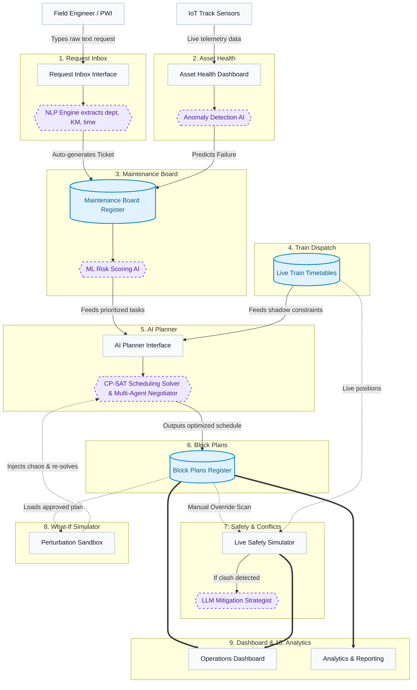

# RailMind AI: Complete Master Workflow

This document provides a holistic, visual overview of exactly how data flows through the entire RailMind AI application, from the moment a defect is found on the track to the moment the system generates a post-operation analytics report.

## The Master Application Flowchart

The following flowchart illustrates the lifecycle of a maintenance task and how the 10 different modules of the application interact with each other.

---

## Step-by-Step Flow Explanation

If you have zero knowledge of the application, follow this exact path to understand how a problem gets solved:

### Phase 1: Problem Detection (Inputs)
A problem enters the RailMind system through one of two ways:
1. **Human Input (The Request Inbox)**: A field engineer sees a broken rail. They open the **Request Inbox** and type "Broken rail at KM 15". The **NLP Engine (AI)** automatically reads this text, understands it's an engineering problem, and converts it into a formal digital ticket.
2. **Machine Input (Asset Health)**: Sensors on the track send live data to the **Asset Health** module. The **Anomaly Detection AI** notices a sensor vibrating dangerously and automatically generates a formal digital ticket before the track even breaks.

### Phase 2: Prioritization (The Backlog)
3. Both the human tickets and machine tickets are dumped into the **Maintenance Board**. 
4. Because there are thousands of tickets, the **ML Risk Scoring AI** instantly grades every single ticket from 0 to 100 based on how dangerous it is. High-risk tickets are pushed to the top of the pile.

### Phase 3: The Brain (Planning)
5. On Friday, the Chief Controller opens the **AI Planner** to schedule next week's work.
6. The AI Planner grabs the prioritized tickets from the Maintenance Board. It also grabs the live train schedules from the **Train Dispatch** module.
7. The **CP-SAT Solver (AI)** runs millions of mathematical calculations to figure out exactly when to fix the tracks *without* delaying the trains. 

### Phase 4: Execution & Safety
8. The AI Planner dumps its finished schedule into the **Block Plans** register. It is marked as a `DRAFT`.
9. The Chief Controller reviews the draft. If they want to double-check it for safety, they run it through the **Safety & Conflicts** scanner. If a clash is found, the **LLM Mitigation AI** tells the controller exactly how to fix it in plain English.
10. The Controller approves the plan. 

### Phase 5: Emergencies & Monitoring
11. If a sudden emergency happens (like a storm), the controller uses the **What-If Simulator** to test how the storm will ruin the approved Block Plan, safely figuring out a backup plan without touching the real schedule.
12. Meanwhile, all live statistics (how many blocks are active, how many delays were prevented) are constantly fed to the **Operations Dashboard** (for real-time monitoring) and the **Analytics** module (for end-of-month executive reports).
